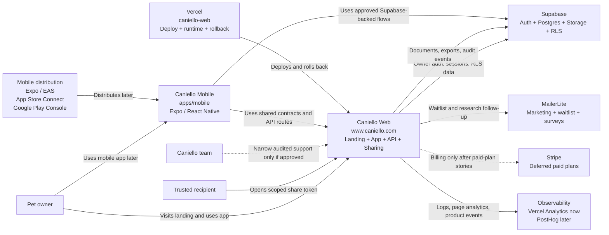
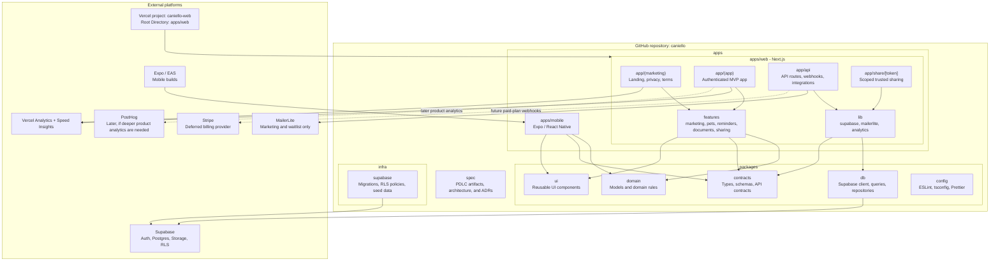
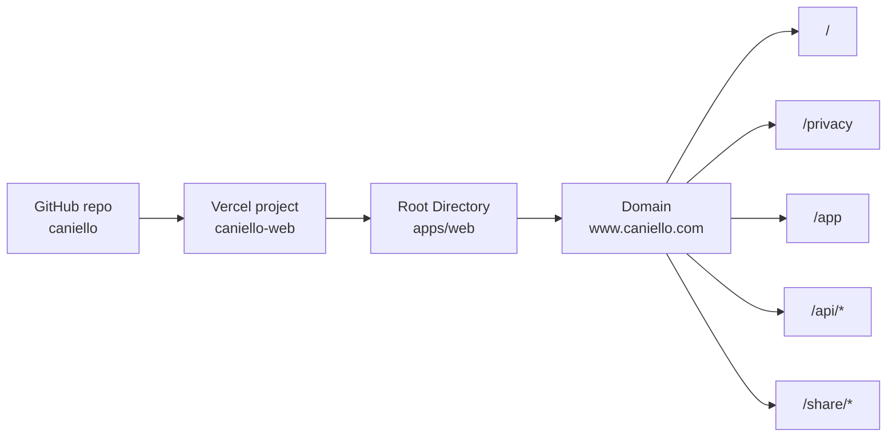
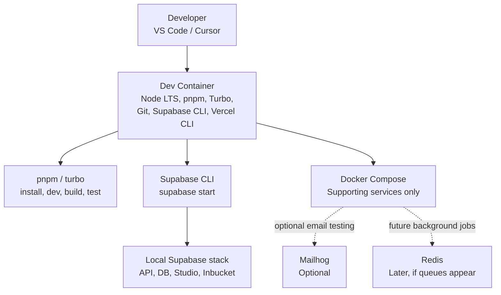
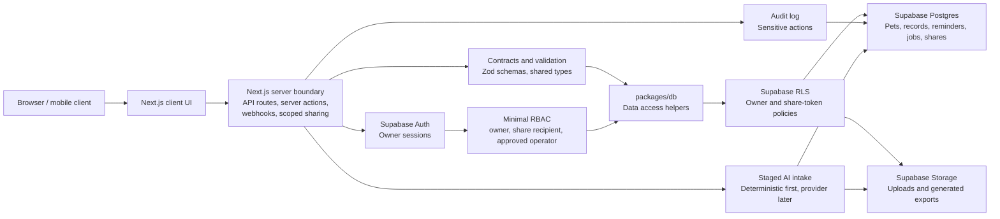

# Caniello MVP Target Architecture

## Status

Accepted

## Date

2026-05-17

## Related decisions

- [0001 - Use TypeScript-first Next.js monorepo for Caniello MVP](../architecture-records/0001-use-typescript-nextjs-monorepo.md)
- [0002 - Use Caniello monorepo directory standard](../architecture-records/0002-use-caniello-monorepo-directory-standard.md)
- [0003 - Keep landing, web app, and API in one Next.js project](../architecture-records/0003-keep-landing-app-and-api-in-one-nextjs-project.md)
- [0004 - Use Supabase for MVP data, auth, storage, and RLS](../architecture-records/0004-use-supabase-for-mvp-data-auth-storage-and-rls.md)
- [0005 - Deploy the web application on Vercel](../architecture-records/0005-deploy-web-on-vercel.md)
- [0006 - Use pnpm workspaces and Turborepo for the monorepo](../architecture-records/0006-use-pnpm-workspaces-and-turborepo.md)
- [0007 - Use React Native and Expo for mobile](../architecture-records/0007-use-react-native-expo-for-mobile.md)
- [0008 - Use MVP product tooling baseline](../architecture-records/0008-use-mvp-product-tooling-baseline.md)
- [0009 - Use one Vercel project for Caniello MVP](../architecture-records/0009-use-one-vercel-project-for-mvp.md)
- [0010 - Use Dev Containers for local development](../architecture-records/0010-use-dev-containers-for-local-development.md)
- [0011 - Use pragmatic engineering practices from MVP start](../architecture-records/0011-use-pragmatic-engineering-practices-from-mvp-start.md)
- [0012 - Polish-first MVP localization](../architecture-records/0012-polish-first-mvp-localization.md)
- [0013 - Use Vercel and Next.js as the MVP platform topology](../architecture-records/0013-use-vercel-nextjs-platform-topology.md)
- [0014 - Use Supabase Auth with minimal RBAC and audit controls](../architecture-records/0014-use-supabase-auth-minimal-rbac-and-audit.md)
- [0015 - Use Supabase migrations, RLS, and lifecycle controls for MVP data](../architecture-records/0015-use-supabase-data-lifecycle-and-rls.md)
- [0016 - Use a staged AI document intake pipeline](../architecture-records/0016-use-staged-ai-document-intake-pipeline.md)
- [0017 - Use scoped share tokens and defer PDF export](../architecture-records/0017-use-scoped-share-tokens-and-deferred-pdf-export.md)
- [0018 - Use MailerLite for marketing email and defer transactional email choice](../architecture-records/0018-use-mailerlite-for-marketing-and-defer-transactional-email.md)
- [0019 - Use Vercel and Supabase observability with MVP recovery playbooks](../architecture-records/0019-use-vercel-supabase-observability-and-mvp-recovery.md)
- [0020 - Defer Stripe payments until paid-plan stories are approved](../architecture-records/0020-defer-stripe-payments-until-paid-plan-stories.md)

## Summary

Caniello MVP is a TypeScript-first monorepo with one deployable web application on Vercel, one future mobile application under Expo / React Native, shared packages for domain logic and contracts, Supabase for data/auth/storage/RLS, MailerLite for marketing and early-access email, Stripe deferred for future paid plans, and Dev Containers for repeatable local development.

The MVP intentionally excludes a separate FastAPI backend, separate API repository, back-office application, marketplace, bookings, payments, clinic SaaS, AI diagnosis, and official pet passport replacement.

Implementation should follow pragmatic engineering practices from the start: KISS by default, strict TypeScript, framework-native React / React Native / Next.js patterns, and design patterns such as Retry and Factory only where they solve a real boundary or repetition problem.

## System Context

## Runtime Architecture

## Deployment Topology

The MVP does not create:

- `caniello-api`
- `caniello-backoffice`
- `caniello-mobile` on Vercel

Future deployable applications may introduce separate Vercel projects for `apps/backoffice` or `apps/api`, but they are outside MVP.

## Local Development Architecture

Local development uses Dev Containers for the working environment, Supabase CLI for local Supabase services, Docker Compose for auxiliary dependencies, and pnpm / Turborepo to run applications.

## Data and Trust Boundaries

Private pet, document, reminder, and sharing data must cross server-side validation and Supabase RLS boundaries. Shared contracts should define data shapes, while `packages/db` should centralize database access patterns.

## Implementation Notes

- `apps/web` is the only Vercel-deployed application for MVP.
- `apps/mobile` is part of the monorepo but deploys through Expo / EAS and app-store workflows, not Vercel.
- `packages/domain` owns shared domain rules.
- `packages/contracts` owns shared TypeScript types, schemas, and API contracts.
- `packages/db` owns Supabase access helpers.
- `infra/supabase` owns migrations, RLS policies, and seed data.
- `.devcontainer` and Docker Compose support local development only.
- Vercel production deployment should not depend on Dev Containers or Docker Compose.
- KISS is the default implementation posture; abstractions should earn their place through repeated behavior, integration boundaries, or clear lifecycle complexity.
- Retry belongs at transient, repeat-safe boundaries such as integrations, network calls, and future background jobs.
- Factory helpers belong at repeated or environment-specific construction points such as Supabase clients, integration clients, repositories, and test fixtures.
- React, React Native, Expo, and Next.js implementation should use framework-native conventions and keep server/client, web/mobile, and shared-package boundaries explicit.

## Validation

Before implementation planning, this target architecture should be checked against:

- accepted ADR coverage for stack, deployment, monorepo tooling, local development, Supabase, and draft ADR coverage for Milestone 1 decisions 0013-0020;
- route ownership in `apps/web`;
- package ownership under `packages/*`;
- Supabase RLS and migration placement under `infra/supabase`;
- Vercel Root Directory set to `apps/web`;
- engineering practice coverage from ADR 0011, including KISS, Retry, Factory, and React / React Native / Next.js boundaries;
- absence of MVP scope creep into back-office, separate API service, marketplace, bookings, premature Stripe implementation, clinic SaaS, AI diagnosis, or official pet passport replacement.
